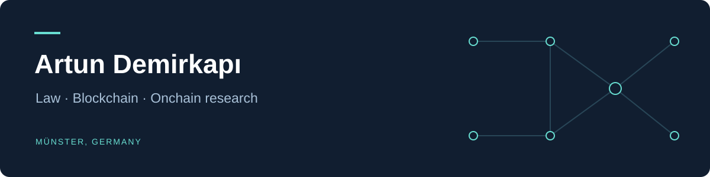

I'm **Artun Demirkapı**, a law student in Münster, Germany, working at the intersection of **company law, decentralized governance, and onchain research**.

Alongside my studies in the *Deutsches Recht* master's programme at the University of Münster, I build tools that turn blockchain activity into structured, inspectable research.

### Selected work

| Project | What it explores | Built with |
| :--- | :--- | :--- |
| **[Wallet Radar](https://github.com/aaarrttun/aaarrttun/tree/main/projects/wallet-radar)** | Read-only token and wallet research on Solana and Robinhood Chain, with explainable scoring and persistent evidence. | TypeScript · Node.js · PostgreSQL |
| **[Wallet Atlas](https://github.com/aaarrttun/aaarrttun/tree/main/projects/wallet-atlas)** | A wallet research workspace with a directory, portfolio views, and a Telegram activity tracker. | React · TypeScript · Cloudflare D1 |
| **[DAO Legal Research](https://github.com/aaarrttun/dao-legal-research)** | How DAOs fit into German and Turkish company law, with a look at Switzerland and Wyoming. | Comparative legal research · German |

Both tools include source code, setup instructions, and tests in the [`projects/`](https://github.com/aaarrttun/aaarrttun/tree/main/projects) directory.

### Research

**Die gesellschaftsrechtliche Einordnung dezentraler autonomer Organisationen (DAOs) im deutsch-türkischen Rechtsvergleich**  
Seminar paper · University of Münster · June 2026

The paper examines legal classification, organizational structure, and participant liability. The repository includes a public reading copy and summaries in **English, German, and Turkish**.

[Read the paper →](https://github.com/aaarrttun/dao-legal-research/blob/main/paper/dao-legal-classification-demirkapi-2026.pdf)

### How I approach the work

- **Evidence first:** keep observations, heuristics, and conclusions distinguishable.
- **Read-only tools:** analyze blockchain activity without signing or submitting transactions.
- **Law and implementation together:** explore the institutions behind decentralized systems while building tools to study them.

**Interests:** DAO governance · comparative company law · blockchain analytics · legal technology

Open to conversations and collaboration around these topics.
