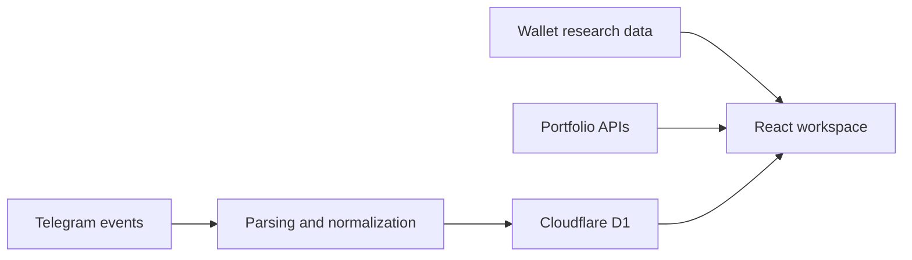

# Wallet Atlas

**A workspace for organizing wallet research and inspecting onchain activity.**

Wallet Atlas brings a wallet directory, portfolio views, and a Telegram activity tracker into one interface. It separates observed activity from inferred relationships so research can be revisited and refined.

Built by [Artun Demirkapı](https://github.com/artundem) with **React, TypeScript, Vinext, Drizzle, and Cloudflare D1**.

## What it does

- Organizes Solana and EVM wallets with labels, categories, and research notes.
- Displays portfolio information through chain-specific read-only routes.
- Parses Telegram transfer and trade messages into structured events.
- Matches events against a locally maintained directory.
- Stores directory changes and tracker state in Cloudflare D1.
- Includes focused tests for parsing, presentation, naming, and event identity.

## Architecture



## Local setup

Requires **Node.js 22.13+** and **pnpm**.

```bash
git clone https://github.com/artundem/artundem.git artun-portfolio
cd artun-portfolio/projects/wallet-atlas
pnpm install --frozen-lockfile
pnpm test
pnpm build
pnpm dev
```

This public snapshot starts with an empty research dataset. Add your own records through your configured directory or supply a dataset matching `data/wallet-data.json`.

Database-backed actions require the `DB` D1 binding and the migrations in `drizzle/`. The included `.openai/hosting.json` declares the logical binding only; it contains no deployed project identifier. Production deployment requires your own hosting and authentication configuration. Authentication headers in `app/chatgpt-auth.ts` assume a trusted gateway and are not a standalone authentication system.

## Source map

| Path | Purpose |
| :--- | :--- |
| `app/` | Workspace UI and API routes |
| `lib/telegram-transfer.ts` | Telegram message parsing |
| `lib/tracker-presentation.ts` | Event presentation |
| `lib/wallet-naming.ts` | Wallet categories and labels |
| `db/` | Drizzle schema and D1 access |
| `drizzle/` | Database migrations |
| `tests/` | Unit tests |

## Public source edition

Private wallet lists, personal ownership annotations, deployment identifiers, and the operator-specific Telegram sidecar are excluded. Data-only migrations from the private installation are replaced with no-op statements; schema migrations are preserved. The included dataset is empty. Telegram source filters and test examples use demonstration labels; configure `lib/telegram-sources.ts` for your own feeds.

Read-only chain access is used throughout. Wallet relationship labels are research annotations, not verified real-world identity claims.

## Related work

- [Wallet Radar](https://github.com/artundem/artundem/tree/main/projects/wallet-radar): explainable wallet scoring and evidence snapshots.
- [DAO Legal Research](https://github.com/artundem/dao-legal-research): German–Turkish comparative company-law study.
