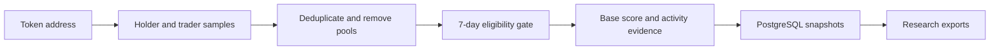

# Wallet Radar

**Read-only token and wallet research on Solana and Robinhood Chain.**

Wallet Radar turns a token address into an evidence-backed set of wallet observations. It combines holder and trader discovery, a documented eligibility gate, explainable scoring, and PostgreSQL snapshots that preserve the research trail.

Built by [Artun Demirkapı](https://github.com/artundem). This repository is the public source snapshot of the research engine.

The public edition includes **33 focused tests** for scanning, scoring, evidence handling, and the optional Telegram research inbox.

## What it does

- Starts from a token address supplied by the operator.
- Combines GMGN holder and top-trader samples, then deduplicates candidate wallets.
- Evaluates seven-day wallet activity with a transparent gate and a versioned score.
- Stores retained observations, provider responses, and evidence in PostgreSQL.
- Uses Helius for Solana transfer and relationship evidence, alongside Robinhood RPC and Blockscout adapters.
- Supports an optional paired Telegram inbox for manually requested research.

The system analyzes activity; it does not sign or submit blockchain transactions.

## Research flow



## Scoring

The current v2 model has a **43-point base score** and a **20-point evidence-based bonus**, for a maximum of **63**. The base score covers return distribution, token breadth, holding time, buy activity, and native balance. The bonus checks for a low-market-cap entry followed by a qualifying realized return within the inspected activity window.

| Stage | Rule |
| :--- | :--- |
| Eligibility | 1–71 seven-day buys; at least two tokens; GMGN follow count no greater than 200 when available |
| Score 0–4 | No per-wallet record retained |
| Score 5–20 | Retained in PostgreSQL |
| Score 21–63 | Eligible for the research dashboard's export policy |

Historical v1 records keep their 43-point scale. The score is a research heuristic; its components and evidence matter more than the headline number.

## Local setup

Requires **Node.js 22.5+** and **pnpm**.

```bash
git clone https://github.com/artundem/artundem.git artun-portfolio
cd artun-portfolio/projects/wallet-radar
pnpm install --frozen-lockfile
cp .env.example .env
# Configure the providers you intend to use.
pnpm build
pnpm test
```

For the PostgreSQL-backed scoring flow:

```bash
pnpm db:local:setup
pnpm db:local:start
# In a second terminal:
pnpm start -- scan-token-scored <TOKEN_ADDRESS> --chain solana
# Or use --chain robinhood for Robinhood Chain.
```

The bundled local database helper uses a development-only database on `127.0.0.1:55432`. Configure your own `DATABASE_URL` for another database. Provider access is required for live research; the unit tests use fixtures.

## Source map

| Path | Purpose |
| :--- | :--- |
| `src/scored-token-scanner.ts` | Candidate gate, score, evidence collection, and retention |
| `src/scanner.ts` | Transfer and relationship research |
| `src/providers/` | Provider adapters |
| `src/telegram.ts` | Paired, manual research inbox |
| `migrations/` | PostgreSQL schema and scoring policies |
| `scripts/` | Database helpers and research exports |

## Scope of the public snapshot

The private deployment, dashboard dataset, API credentials, database files, Telegram connection, and operational history are excluded. The repository contains the research engine and its tests; dashboard deployment is managed separately.

Coverage depends on provider sampling and pagination. Wallet relationships are hypotheses supported by transaction evidence, not proof of a real person's identity. A raw token transfer alone is not treated as evidence of a trade or profit.

## Related work

- [Wallet Atlas](https://github.com/artundem/artundem/tree/main/projects/wallet-atlas): wallet research workspace.
- [DAO Legal Research](https://github.com/artundem/dao-legal-research): German–Turkish comparative company-law study.
